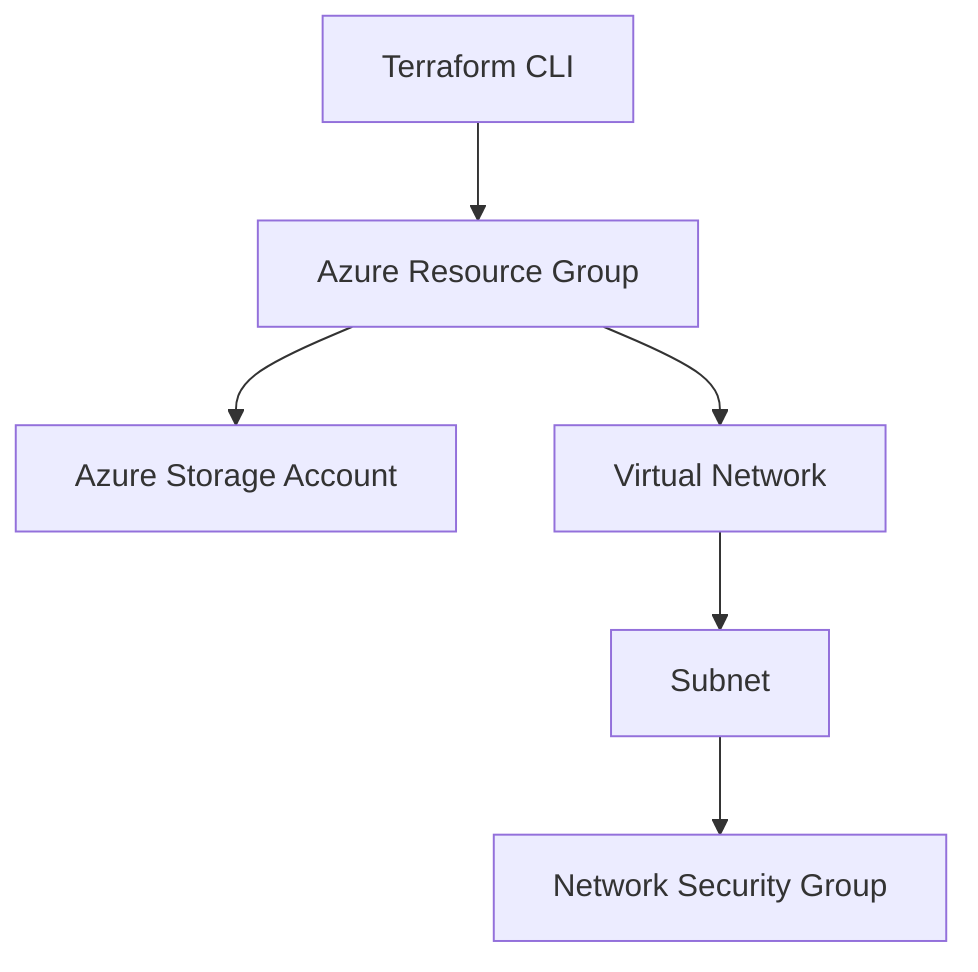

# Azure Infrastructure as Code – Terraform Lab

A hands-on cloud infrastructure project built with
Microsoft Azure, Terraform, Azure CLI and GitHub.

## Project Overview

This project demonstrates how to provision and manage
Azure infrastructure using Infrastructure as Code (IaC).

## Architecture



## Technologies

- Microsoft Azure
- Terraform
- Azure CLI
- Git & GitHub
- GitHub Actions
- Visual Studio Code

## Azure Resources

| Resource | Purpose |
|---|---|
| Resource Group | Infrastructure organization |
| Storage Account | Cloud data storage |
| Virtual Network | Private Azure networking |
| Subnet | Network segmentation |
| Network Security Group | Network traffic control |

## Deployment

Prerequisites: Terraform, Azure CLI and an Azure
subscription with appropriate permissions.

```bash
az login
export ARM_SUBSCRIPTION_ID=$(az account show --query id -o tsv)
terraform init
terraform validate
terraform plan
terraform apply
```

Run Terraform commands from the directory containing main.tf.

## CI/CD

GitHub Actions automatically runs Terraform formatting
and configuration validation on pushes and pull requests.
Infrastructure deployment is performed locally.

## Security

- Terraform state files are excluded from Git.
- No credentials are stored in the repository.
- No public virtual machines are deployed.

## Project Status

Azure infrastructure deployed and managed with Terraform.

## Future Improvements

- Remote Terraform state in Azure Blob Storage
- Reusable Terraform modules
- Automated Azure deployment with GitHub Actions
```

